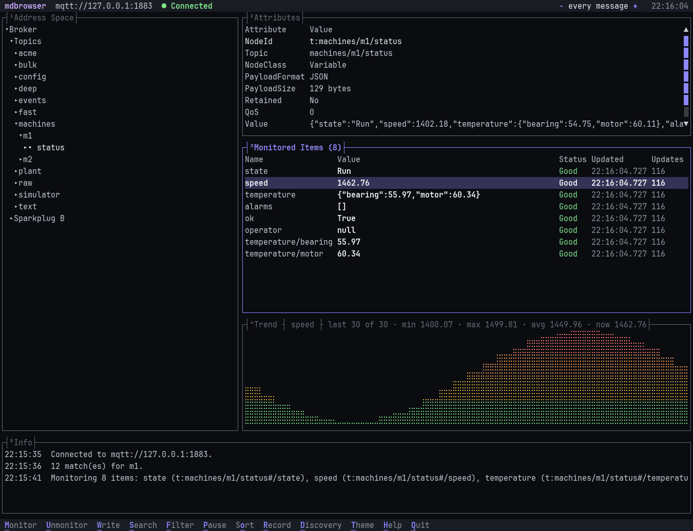
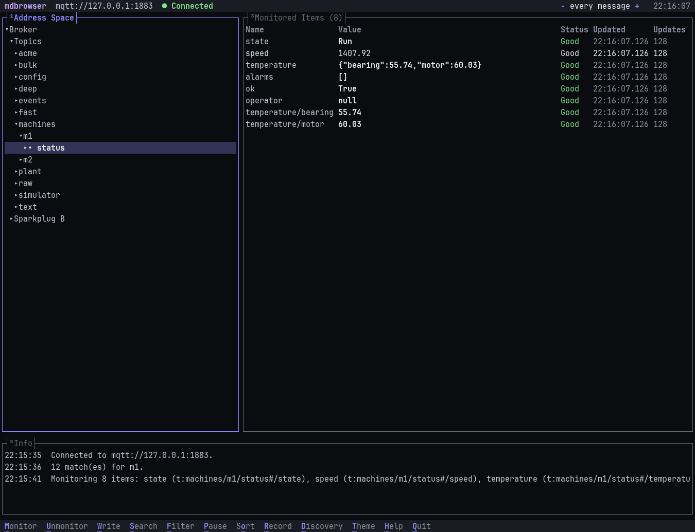
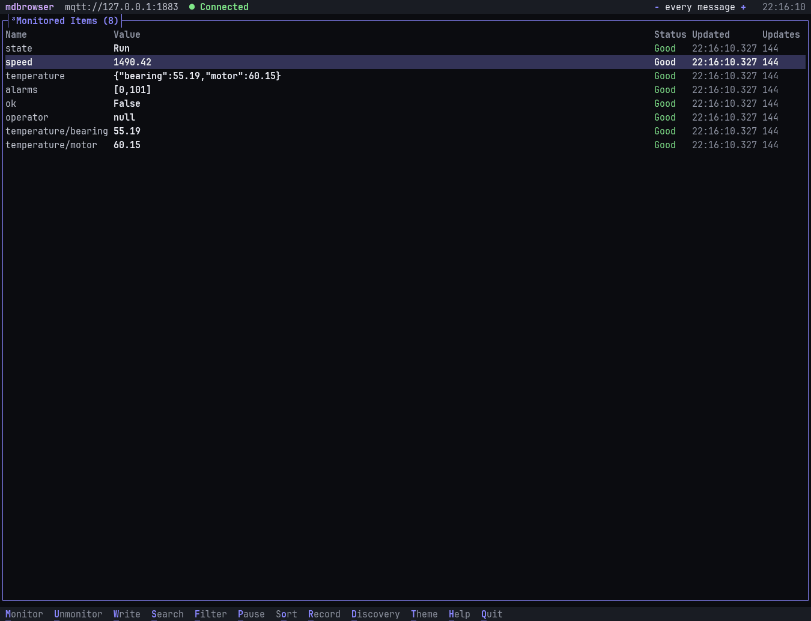
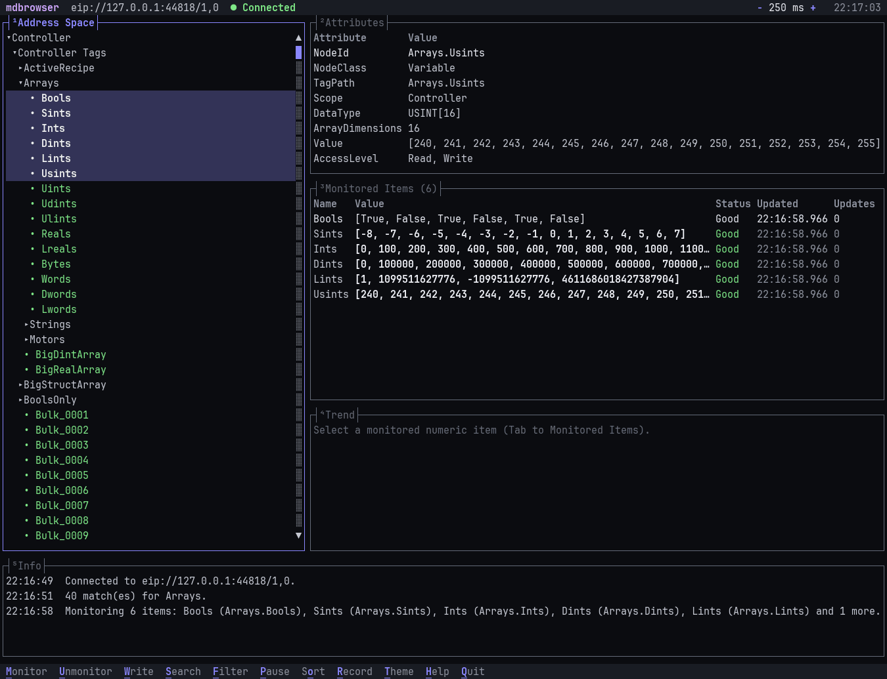
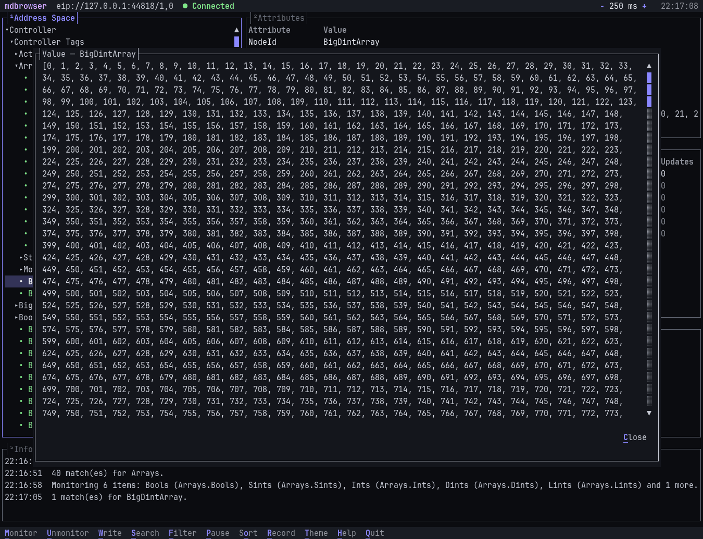
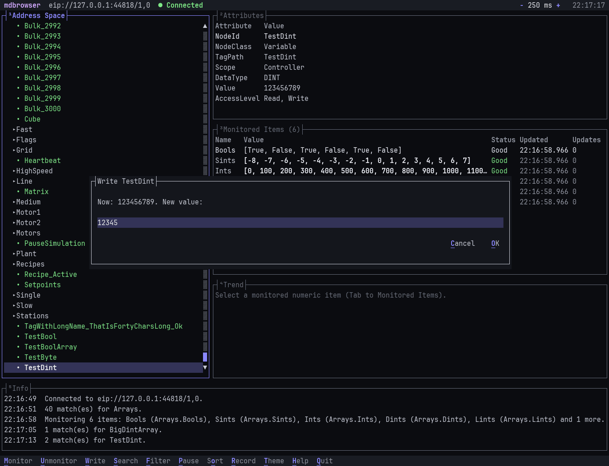
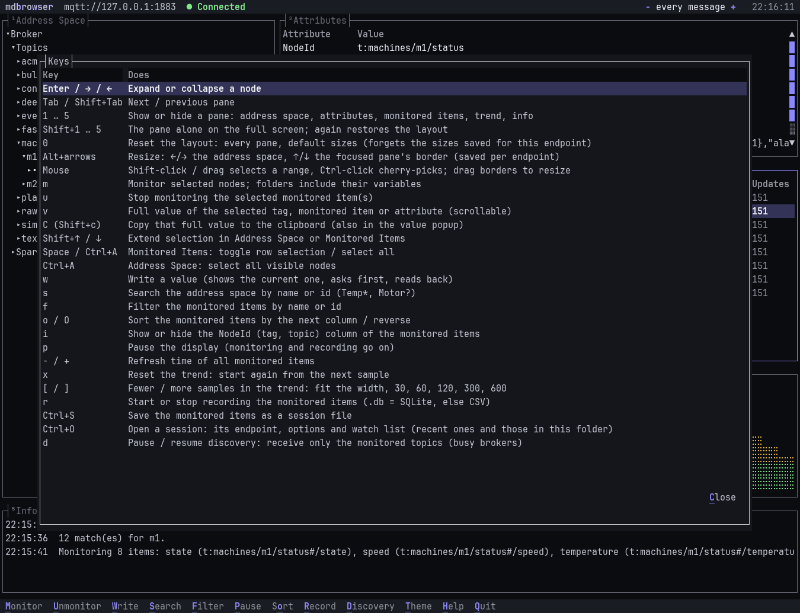

# Command line (`mdbrowser`)

`mdbrowser` does the browsing and monitoring of the app from a terminal or a script: list endpoints, browse the
address space, read and write values, stream live values, and create and run the app's sessions. It speaks the same
protocols as the app: **OPC UA**, **EtherNet/IP (Logix and PCCC)**, **Modbus TCP** and **MQTT** (Sparkplug B, CloudEvents).

## Install

```sh
brew install zaoralj/tap/mdbrowser        # macOS and Linux
```

Or download `mdbrowser-<version>-<os>-<arch>.tar.gz` from the
[releases](https://github.com/ZaoralJ/MachineDataBrowser/releases) and put `mdbrowser` on your `PATH`. It is a single
self-contained file; no .NET installation is needed.

## Commands

Tip: in the app, right-click nodes in the Address Space or rows in Watch ▸ **Copy mdbrowser command** to get a ready
command line for them, with the endpoint and options of the connection.

| Command | Does |
|---|---|
| `mdbrowser endpoints <url>` | the endpoints of an OPC UA server: security mode, policy, logins, certificate thumbprint |
| `mdbrowser browse <url> [node] [--depth N]` | the address space below a node (default: the root) |
| `mdbrowser read <url> <node>... [-R]` | the current value and data type of one or more variables |
| `mdbrowser monitor <url> <node>... [-R]` | live values until Ctrl+C, `--duration` or `--count` |
| `mdbrowser write <url> <node> <value>` | write a value (or several with `--set`); asks first unless `--yes` |
| `mdbrowser session create <file> <url> <node>...` | a session file for the app with these nodes as its watch list |
| `mdbrowser session add <file> <node>...` | adds nodes to a session's watch list; everything else in the file is kept |
| `mdbrowser session remove <file> <node>...` | removes items from a session's watch list (`rm`; `-R` for a folder), offline |
| `mdbrowser run <session>` | the watch list of a session file saved by the app (`.mdbsession`), each item at its refresh time |
| `mdbrowser tui <url or session>` | a full-screen browser in the terminal: tree, attributes, live values, trend, write, record; see [below](#full-screen-browser-tui) |
| `mdbrowser mcp --endpoint <url>... --recording <file.db>...` | an MCP server for AI agents (machines and SQLite recordings), read-only; see [MCP server](mcp.md) |

For the interactive browser, `mdbrowser <url>` is shorthand for `mdbrowser tui <url>`.

`mdbrowser <command> --help` lists every option.

```sh
mdbrowser opc.tcp://127.0.0.1:4841
mdbrowser endpoints opc.tcp://127.0.0.1:50000
mdbrowser browse opc.tcp://127.0.0.1:4841 /Objects/Custom/Machines --depth 2
mdbrowser read eip://127.0.0.1:44818/1,0 "/Controller Tags/Motor1/Speed"
mdbrowser read modbus://127.0.0.1:5020/1 hr:20:float32 hr:50:string16 co:1
mdbrowser monitor modbus://127.0.0.1:5020/1 /Tags/Simulator -R --map simulators/modbus/simulator-map.csv
mdbrowser monitor "mqtt://127.0.0.1:1883/machines/#" /Topics/machines/m1/status/speed --duration 10m
mdbrowser monitor opc.tcp://127.0.0.1:4841 /Objects/Custom/Machines --recursive --depth 3
mdbrowser run line1.mdbsession --format csv > shift.csv
```

### Nodes

A node is either a **path** of display names from the root, starting with `/`, or an **id**:

- `/Objects/OpcPlc/Telemetry/Basic/StepUp`, `"/Controller Tags/Motor1/Speed"` (quote paths with spaces),
  `/Topics/machines/m1/status`;
- `ns=3;s=StepUp` or the portable `nsu=http://…;s=StepUp` (OPC UA), a tag name like `Motor1.Speed` (Logix), a
  data-table address like `N7:0` or `T4:0.ACC` (PCCC), an MQTT id as the app shows it, e.g. `t:plant/hall1/press1/temperature` or `t:machines/m1/status#/speed` for a JSON field,
  or `"m:Plant1|Edge1|Press1|Temperature"` for a Sparkplug B metric (group, edge node, device, metric; quote the `|`).
  A fresh connection learns Sparkplug metric names from the next birth, so use these ids rather than paths for them
  ([example](cli-examples.md#monitor-sparkplug-b-metrics));
- a Modbus address `area:address[:type][:swap]`, 0-based: `hr:100`, `hr:20:float32`, `hr:22:float32:swap`,
  `ir:4:int32`, `hr:50:string16`, `co:3`, `di:0` (see the [user manual](user-manual.md#modbus)), or a path like
  `"/Holding Registers/0-99/20"`, or with a register map `/Tags/Line1/Speed`.

**Modbus register maps:** `--map file.csv` (`-m`) names the device's addresses for this command; the names appear
under `/Tags`. The file has one line per value, `name,address[,unit][,description]`, with `/` in names for folders:

```text
name,address,unit,description
Line1/Motor/Speed,hr:20:float32,rpm,Motor speed
Line1/Running,co:1
```

`session create` and `tui` (`Ctrl+S`) store the map in the session file (`tagMap`, relative to the session when it
is in the same folder or below); `run`, `session add`, `tui` and `mcp --session` load it from there.
`simulators/modbus/simulator-map.csv` is the map of the [Modbus simulator](simulators.md#modbus-simulator-simulatorsmodbus).

`browse` prints full paths, so its output can be passed to `read` and `monitor` as it is.

**JSON on MQTT topics:** each property of a JSON payload is a node below its topic, nested objects too, read and
monitored with its own type: `/Topics/machines/m1/status/speed` or `/Topics/machines/m1/status/temperature/motor`
(id `t:machines/m1/status#/temperature/motor`); the topic itself gives the whole payload. `-R` on the topic covers
every property. See the [examples](cli-examples.md#read-properties-from-the-json-on-a-topic).
The app's MQTT tree is a live cache of messages it has received; a non-retained topic can still be visible there after a
fresh CLI connection cannot browse it. `monitor` accepts an uncached `/Topics/...` path as a literal MQTT topic and
subscribes for future messages. The app's **Copy mdbrowser command** uses the MQTT id (including JSON pointers) so it
doesn't lose that distinction.

### Whole folders (`--recursive`)

With `-R` / `--recursive`, `read` and `monitor` expand each folder, object or Logix structure to every variable below
it, like *Monitor folder* in the app:

| Option | |
|---|---|
| `--depth N` | levels below each node (default 10) |
| `--max-items N` | at most this many variables in total (default 500); a note on stderr says when the limit was hit |

- Items are named by their path below the node you passed (`Basic/StepUp`, `Station/Name`), so equal names in
  different folders stay apart.
- A variable you pass directly is read or monitored itself. OPC UA properties of variables (EURange, EngineeringUnits)
  are left out.
- MQTT: a topic with a JSON payload expands to its fields (`status/speed`, `status/temperature/bearing`).
- Nothing found within `--depth` is an error (exit 1).

### Sessions

A session file (`.mdbsession`) is what the app saves with File ▸ Save: the endpoint, its options and the watch list.
The command line reads and writes the same files, so a watch list can go both ways between the app and scripts.

!!! tip "One session, kept in sync everywhere"
    Every running instance that has a session open follows its file: the app, `mdbrowser tui` and `mdbrowser run`.
    Change the session in any of them — save in the app or the TUI (`Ctrl+S`), `mdbrowser session add` / `remove`,
    or an editor — and the others pick it up at once: the app and the TUI reload it, `run` switches to the new watch
    list without reconnecting. Only when reloading would drop unsaved changes or stop a recording do the app and the
    TUI ask first.

```sh
mdbrowser session create line1.mdbsession opc.tcp://127.0.0.1:4841 /Objects/Custom/Machines/Machine1 -R -r 1000 --trust-all
mdbrowser session add line1.mdbsession /Objects/Custom/Machines/Machine2/Speed "ns=2;i=29"
mdbrowser session remove line1.mdbsession /Objects/Custom/Machines/Machine2/Speed      # -R removes a whole folder
mdbrowser monitor opc.tcp://127.0.0.1:4841 /Objects/Custom/Machines/Machine1/Speed --save quick.mdbsession
mdbrowser run line1.mdbsession                                                         # or File ▸ Open in the app
```

- Nodes are saved like the app saves them: portable ids (`nsu=…`, stable across server restarts) with their name and
  path, so Watch can group them by path. `-R`, `--depth` and `--max-items` work as for `read`.
- Options are saved (user name, `--secure`, `--trust-all`, `--map`, `-r` as the session's default refresh); **never a
  password**. `session add` and `run` take it from `--password` or `MDBROWSER_PASSWORD`.
- `session create` and `--save` don't overwrite an existing file without `--force`. `session add` connects with the
  file's endpoint, skips nodes already in the watch list and keeps everything else (bookmarks, columns, display
  formats, monitoring settings).
- Nodes given by id are checked with the device first; one that doesn't exist is an error and nothing is written.
- `session remove` doesn't connect: it matches the path and name as shown, the name alone (every item with it), or the saved id
  (`nsu=…;s=Speed`, or just `s=Speed`). A node that matches nothing is an error and nothing is removed.
- `run` and `tui` follow their session file: when the app, another `tui` or `session add` changes it, `run`
  monitors the new watch list (rows still watched keep their values and update counts; it reconnects only when the
  endpoint or its options changed; `--duration`, `--count` and `--record` continue). `tui` reopens the session,
  and asks first when that would drop monitored items changed there or a running recording.

### Recording to a file

`monitor` and `run` record every sample with `--record <file>`, alongside what they show:

```sh
mdbrowser monitor opc.tcp://127.0.0.1:4841 /Objects/Custom/Machines -R -r 500 --record line1.db     # SQLite
mdbrowser run line1.mdbsession --duration 8h --record shift.db
mdbrowser monitor opc.tcp://127.0.0.1:4841 /Objects/Custom/Machines/Machine1/Speed --record speed.csv  # CSV
```

`--retention 30d` (SQLite only) deletes samples older than that from the file while recording, so an always-on
recording doesn't grow without end:

```sh
mdbrowser run line1.mdbsession --record plant.db --retention 30d
```

It is the same file the app writes with *Also write to file*: SQLite for `.db` / `.sqlite` (one more recording in the
file each time, queryable with SQL; see [Recording to SQLite](user-manual.md#recording-to-sqlite)), CSV otherwise. The
app's recording viewer opens either. The file is the store, so a recording can run for days without growing memory.

### Writing values

```sh
mdbrowser write opc.tcp://127.0.0.1:4841 /Objects/Custom/DataTypes/Double 42.5
mdbrowser write eip://127.0.0.1:44818/1,0 Arrays.Lreals "[1.5, 2.5, 3.5, 4.5]"
mdbrowser write opc.tcp://127.0.0.1:4841 --set /Objects/Custom/DataTypes/Int16=-321 --set /Objects/Custom/DataTypes/Double=42.5 --yes
```

- The value is text, converted to the variable's data type like *Write value…* in the app: numbers, `true`/`false`,
  text; arrays comma-separated, optionally in brackets. What each protocol writes is described in the
  [user manual](user-manual.md#writing-values).
- **It asks first.** In a terminal, `write` shows the current and new values and asks for confirmation (default *no*).
  `--yes` skips the question; without a terminal (a script, a pipe) and without `--yes` it refuses rather than guess.
- After writing it reads the values back and prints *before*, *after* and the result per item, so a write the device
  accepted but didn't apply is visible. MQTT values come back through the broker; `write` waits up to 2 s for them.
- `--set node=value` writes several in one go. Paths split at the first `=` (values may contain `=`), ids at the last
  (`--set "ns=2;i=48=-321"`); for a value with `=` on an id, use `write <url> <id> <value>`.
- Exit code 1 when any value was not written; the reason is in the *result* column (`-f json`: `written`, `error`).

### Full-screen browser (`tui`)

`mdbrowser tui` is the app in a terminal, for every protocol: over SSH, on a headless box next to the line, or
when a window is one too many.

```sh
mdbrowser tui opc.tcp://127.0.0.1:4841
mdbrowser tui eip://127.0.0.1:44818/1,0
mdbrowser tui mqtt://127.0.0.1:1883
mdbrowser tui modbus://127.0.0.1:5020/1 --map simulators/modbus/simulator-map.csv
mdbrowser tui line1.mdbsession          # the session's endpoint, options and watch list, monitored at once
```



Five panes: **¹** address space, **²** attributes of the selected node, **³** monitored items, **⁴** a trend
chart of the selected (numeric) item, **⁵** an info log. The header shows the endpoint and its state, the
refresh time and, while recording, the file and sample count. Every action is a key; the bar at the bottom shows
the main ones and `h` lists them all. Click a pane to focus it. Drag the border between two panes with the mouse
to resize them (or `Alt+←`/`→` for the address space, `Alt+↑`/`↓` for the focused pane's border); a
double-click on a border restores its default size. The sizes and the panes hidden with `1` … `5` are remembered
per endpoint URL (in `tui-layouts.json` in the data folder, not in the session file); `0` resets the layout.
Attributes, Monitored Items, Trend and Info show vertical scrollbars when their content extends beyond the pane.

| Key | Does |
|---|---|
| `Tab` / `Shift+Tab`, `→` / `←` / `Enter` | move between panes; expand and collapse nodes |
| `1` … `5` / `Shift+1` … `5` | show or hide a pane / the pane alone on the full screen (again restores the layout) |
| `0` | reset the layout: every pane shown, default sizes, the endpoint's saved layout forgotten |
| `Alt+←` `→` / `Alt+↑` `↓` | resize the address space / move the focused pane's border (like dragging it) |
| `m` / `u` | monitor selected address-space nodes (folders include variables) / stop monitoring selected rows |
| `v` | the full value of the selected tag, monitored item or attribute in a scrollable popup |
| `C` (`Shift+c`) | copy that full value to the clipboard, also inside the popup (`⌘C` stays the terminal's own copy) |
| `Shift+↑` / `Shift+↓`, Shift-click or drag | extend tree/watch selection; `m` / `u` act on it |
| Ctrl-click | cherry-pick a tree node or monitored row |
| `Space` / `Ctrl+A` | Monitored Items: toggle row / select all; Address Space: select visible nodes |
| `w` | write a value: shows the current one, asks first, reads it back |
| `s` | search the address space by name or id (`Temp*`, `Motor?`) and go to a match |
| `f` / `o` `O` / `i` / `p` | filter the monitored items / sort by a column, reverse / show the NodeId column / pause the display |
| `-` / `+` | refresh time of all monitored items |
| `x` / `[` `]` | reset the trend / fewer or more samples in it (fit the width, 30 at first, 60, 120, 300, 600) |
| `r` | start or stop recording the monitored items: SQLite for `.db`, CSV otherwise (like `--record`) |
| `Ctrl+S` | save the monitored items as a session file; an existing one keeps everything else |
| `Ctrl+O` | open a session (the app's recent ones, those in this folder, or any file): its endpoint, options and watch list, in place |
| `y` / `a` / `e` | OPC UA: history of the variable / current alarms / live events |
| `d` | MQTT: pause discovery, receiving only the monitored topics (like *Pause discovery* in the app) |
| `k` | Modbus: load a register map (or remove it with an empty path); reconnects, keeps the monitored items; `Ctrl+S` stores it |
| `g` / `t` / `l` | connection diagnostics / next colour theme / light or dark |
| `q` | quit |

- **Colours** are the app's themes ([all of them](themes.md)), the one chosen in the app by default; `--theme Nord`
  and `--light` pick another for this run, `t` and `l` switch while running. Status is green, amber or red; stale
  values are dimmed.
- **Writes** follow the session: a read-only session never writes. Names keep their underscores (`Bulk_0014`).
- The display can pause (`p`) while monitoring and any recording go on; `-`/`+` change the rate at the device.
- Dialogs take their buttons' letters (`c` Close, `g` Go to, `y` / `n`); text prompts use a steady block cursor. In
  file prompts, `Tab` completes paths and `↑` / `↓` select among multiple matches. The *Write* prompt selects the
  current value, so typing replaces it; move the cursor to edit only part of it.
- It needs an interactive terminal; scripts use `browse`, `read` and `monitor`.

#### In pictures

Panes come and go with `1` … `5`; here Attributes (`2`) and Trend (`4`) are hidden and the others take their room.



`Shift+3` shows Monitored Items alone on the full screen; again restores the layout.



Several tags selected with `Shift+↓` (or Shift-click, drag, Ctrl-click) and monitored at once with `m`.



`v` shows the whole value — here a Logix array of 5000 numbers — in a scrollable popup; `C` copies it.



`w` writes: the prompt shows the current value and asks for the new one; it asks again before writing.



`h` lists every key.



See the [command line examples](cli-examples.md) for the other commands with their output.

### Connection options

| Option | |
|---|---|
| `-u, --user` / `-p, --password` | login (OPC UA, MQTT); the password can also come from `MDBROWSER_PASSWORD` |
| `--secure` | OPC UA: the most secure endpoint the server offers |
| `--trust-all` | accept untrusted server certificates; for lab networks only |
| `-m, --map` | Modbus: register map (CSV) naming the device's addresses; overrides the session's |

`mdbrowser` shares the app's data folder: certificates trusted in the app are trusted here, and the OPC UA client
identity is the same, so a server that trusts the app trusts the command line too. `run` takes the endpoint, login
name and options from the session; passwords are never saved, so pass `--password` or set `MDBROWSER_PASSWORD`.

### Output

| `--format` | In a terminal | Redirected (pipe, file) |
|---|---|---|
| `text` (default) | tables, a tree for `browse`, a live table for `monitor`/`run` that updates in place, coloured status | aligned plain text, one line per update |
| `json` | `read`/`browse`/`endpoints`: a JSON array; `monitor`/`run`: one JSON object per line, values keep their type | same |
| `csv` | a header line, then rows | same |

Decoded OPC UA complex values show their named fields. JSON uses nested objects; text and CSV put compact JSON in the
value column (quoted as needed by CSV).
The OPC UA Decimal built-in is the exception: text and CSV show its exact numeric text, while JSON keeps its lossless
`Scale` and `Value` fields.

The live table starts with the current values, read when monitoring starts; *Updates* then counts the changes that
arrived (the device's first notification that only repeats the starting value isn't counted). Redirected output and
JSON/CSV stream only the notifications.

Text and CSV show names only; add `--ids` (`read`, `write`, `monitor`, `run`) for an id column next to the name.
When two items have the same name, ids are shown anyway. JSON always includes `id`, and `monitor`/`run` CSV too.

```sh
mdbrowser read opc.tcp://127.0.0.1:4841 /Objects/Custom/Machines/Machine1/Speed -f json | jq '.[0].value'
mdbrowser monitor opc.tcp://127.0.0.1:4841 /Objects/Custom/Machines -R -f json | jq -c 'select(.status != "Good")'
```

### Stopping and exit codes

`monitor` and `run` stop on Ctrl+C (or SIGTERM), after `--duration` (`30s`, `5m`, `8h`, `1d`, `500ms` or `hh:mm:ss`) or
after `--count` updates, and close the connection properly.

| Exit code | |
|---|---|
| `0` | success, or a stream that ended normally |
| `1` | an error (one line on stderr, `mdbrowser: …`), or a `read` where a value could not be read |
| `130` | cancelled before the command finished (e.g. Ctrl+C during `read`) |

Items that can't be monitored are reported on stderr and the rest continue.

`monitor` and `run` keep trying to connect, without messages: a device that is off when they start is picked up once
it is reachable (a wrong URL, certificate or login still fails at once). If the connection drops while streaming,
every item is shown with status `BadNotConnected` and the client retries until the device is back; then all values
are read again so the output is current.
